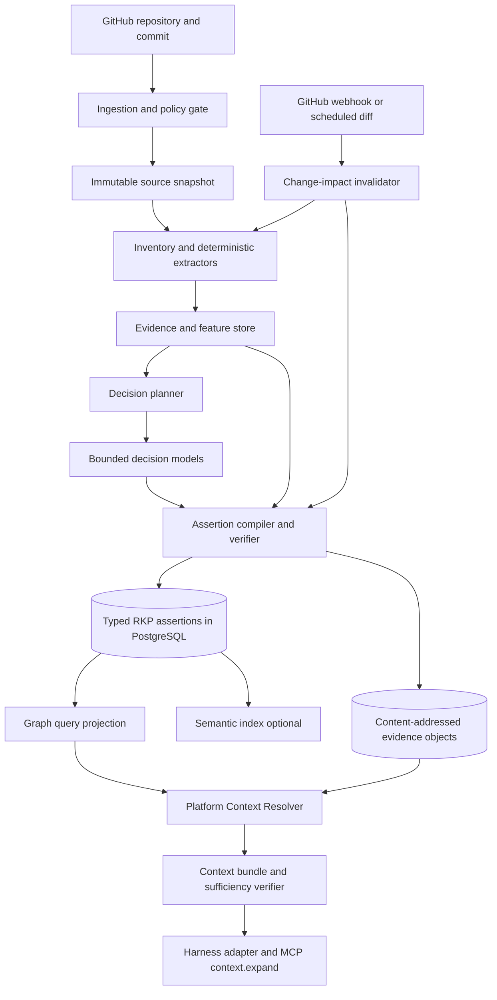

# GitHub Intelligence Engine — Decision-Model Architecture & Build Specification v1.0

**Status:** archived. Superseded by [v2.0](../architecture.md); kept for its design history.  
**Original status:** implementation-ready design proposal (not an assertion that the components exist)  
**Date:** 2026-11-22  
**Alignment:** AI-SDLC Meta-Harness Capability Catalog v0.3, E05 Repository Intelligence, P01 Context, H01 Harness Control.  
**Terminology:** *JEV* denotes the decision-model approach, **not** the entire platform. A decision model is a bounded, versioned decision function, which may use rules, classifiers, small models, or targeted LLM reasoning. The platform owns orchestration, authorization, verification, and persistence.

## 1. Executive design

Build a read-only repository intelligence compiler that transforms a pinned GitHub repository snapshot into a **Repository Knowledge Package (RKP)**. The RKP is a typed, temporal, evidence-backed representation of the software system: repository topology; languages and frameworks; packages, services and entry points; APIs and event contracts; database/storage schemas; AI integrations; security boundaries; build/deployment topology; tests; and source-backed requirement/behavior candidates. Incrementally maintain this knowledge as commits arrive. Expose it to the platform Context Resolver through typed queries, not unrestricted repository-wide LLM scans.

**Principle:** deterministic extractors produce candidate observations; decision models resolve bounded semantic uncertainty; a compiler turns candidates into evidence-backed assertions; verifiers validate invariants; the platform records unknowns and abstentions. *Reproducibility of inputs, decisions and emitted artifacts* is required, not an assertion that model reasoning itself is deterministic.

### Non-goals for v1
- Reconstruct complete business requirements from source alone.
- Claim declared infrastructure is actually running in production.
- Prove dynamic call paths solely from static analysis.
- Automatically execute arbitrary repository scripts, builds, install hooks, tests, or IaC plans on ingestion.
- Give model-generated classifications authority over parsers, policy, or the repository owner.
- Replace harness-native code search: the RKP is a verified starting map and expandable knowledge source.

### Success conditions
- Produce useful topology, technology, service, API, data and deployment inventory on representative Python/TypeScript repos with explicit coverage and unknowns.
- Trace every material assertion to a commit-pinned evidence span or artifact, including extractor/model version.
- On a new commit, invalidate and re-evaluate only affected assertions and dependent edges where possible; preserve historical RKP snapshots.
- Return a task-specific subgraph for `code.modify`, `defect.repair`, `test.unit.generate`, and `change.impact.analyze` with capability-owned `context_profile`.
- Fail closed on unauthorized retrieval; no repository content can become agent instructions merely by appearing in a context bundle.

## 2. Catalog fit and ownership

| Catalog placement | Operations | Ownership and boundary |
|---|---|---|
| E05 existing T | `repo.inventory`, `repo.symbols.index`, `repo.callgraph.construct`, `repo.dependencies.extract` | Read-only extractors; reproducible output, explicit unresolved/coverage |
| E05 existing D+T | `repo.structure.map` | Structural candidates + bounded decisions; shared/generated paths allowed |
| E05 v0.3 | `repo.topology.classify`, `repo.stack.classify`, `repo.services.discover`, `repo.interfaces.extract`, `repo.dataassets.extract`, `repo.ai.integrations.extract`, `repo.deployment.map`, `repo.knowledge.compile`, `repo.knowledge.diff` | Knowledge extraction, classification, compilation, version comparison |
| P01 Context | `context.resolve`, `context.assemble`, `context.snapshot`, `context.version`, `context.redact`, `context.expand`, `context.sufficiency.validate`, `context.invalidate`, `context.hydrate` | Policy-first, task-specific context; transport-neutral core, MCP exposure for expand |
| H01 | `context.instructions`, `context.workspace_bind`, `extend.mcp`, sandbox and permissions | Harness-specific delivery; sandbox/OS/network enforce access |

**Additional internal operations (do not automatically promote to catalog L3):** `evidence.extract`, `decision.evaluate`, `assertion.reconcile`, `coverage.measure`, `artifact.cache.lookup`. These are implementation primitives underneath the existing L3 contracts. New L3 IDs are proposed only after evidence that an independent output contract and verifier are necessary.

**Important:** v0.3's D+T label is retained for semantic E05 operations; internally, deterministic extractors and decision calls must be separately traceable. One L3 output contract, one side-effect class, one platform verifier *entry point* may compose multiple checks.

## 3. Architecture and runtime boundaries



**Trust zones:**
1. **Untrusted source zone:** repository bytes, README, issues, PR descriptions, comments, generated artifacts, and source-derived model inputs. No arbitrary execution. Credentials not mounted.
2. **Extractor zone:** sandboxed parsers and static analyzers with no outbound network unless an explicitly approved operation needs it. Dependency manifests parsed as data, not installed.
3. **Decision zone:** typed feature input, explicit label sets, limited evidence excerpts, output-schema enforcement; repository text always tagged `untrusted_data`.
4. **Trusted control zone:** policy, schema validation, assertion compiler, evidence hashing, audit and publishing; model outputs remain untrusted claims until verified.
5. **Consumer zone:** Context Resolver authorizes queries before graph expansion and hydration; agent workspace, tools and network are independently restricted.

**Temporal:** one workflow per repository/commit compilation, activities for ingestion, extractors, model decisions, compilation and publish. Store large evidence and RKP outputs externally; workflows carry IDs/hashes only. Activities are idempotent or have idempotency keys; model retries produce separately identified attempts. Webhook delivery can be at least once; deduplicate by repo ID, commit, compiler profile and event ID.

## 4. End-to-end compilation workflow

### Stage 0 — Admission and source pinning
Input: GitHub installation/repository identity, requested ref, actor, authorized scope, ingestion profile. Resolve ref to immutable commit SHA. Confirm repo access and allowed data classifications. Create immutable source snapshot and file manifest. Exclude `.git`, vendored binaries, generated trees and oversized files by policy; exclusions are recorded, never silently dropped. Detect submodules, LFS pointers, symlinks, sparse checkout and shallow history; do not follow symlinks outside root. Secret scan before sending any excerpts to remote models. Do not fetch unapproved dependencies.

### Stage 1 — Cheap inventory and fingerprints
Compute path, size, content hash, extension, MIME/syntax guess, generated/vendor classification, ownership signals, changed paths, directory-level manifest indexes. Parse `package.json`, workspace files, `pyproject.toml`, `go.mod`, `pom.xml`, `Cargo.toml`, lockfiles, Dockerfiles, CI workflows, Terraform/Bicep/Helm/Kubernetes, OpenAPI/protobuf/GraphQL, SQL migrations and ORM declarations. Store parser diagnostics and coverage. Language percentages by byte count are a weak signal; use build targets and executable entry points for primary-stack classification.

### Stage 2 — Feature assembly
Produce bounded feature vectors per decision scope: repo, workspace, package, service, interface, data asset, deployment unit. Features are derived from structured observations with evidence IDs. Do not feed entire files by default. Use architecture-aware sampling: manifests and entry points first, then representative routes, models, configuration, tests, and reachable dependency slices. Record sampling strategy and files not inspected.

### Stage 3 — Decision planning and execution
Rules and parsers may fully resolve easy cases. Invoke a decision model only if uncertainty, conflict, or missing relationship exceeds a declared threshold. Model returns typed candidates, supporting and contradicting evidence, uncertainty and `abstain` option. No arbitrary invented entity IDs: candidates reference extracted artifact IDs and valid enum labels. All decisions record feature-set hash, model/prompt/version, threshold policy, elapsed time and token cost where applicable.

### Stage 4 — Assertion compilation
Normalize aliases and IDs, merge duplicate observations, resolve cross-file references, check cardinality and semantic constraints, and generate typed assertions with evidence provenance. A source-backed observation and an inferred relationship are different assertion types. When two observations disagree, preserve both and open a conflict; do not overwrite the older one. Use calibrated confidence only for decision families with calibration data; otherwise store `confidence: null` and an evidence class.

### Stage 5 — Coverage and publish
Compute coverage by domain, language and package, plus unresolved and contradictory counts. Run verifier suite. Publish immutable RKP manifest and graph projection only if mandatory invariants pass. Failed or partial compilation may be stored with `status: partial`, but not advertised as complete. Context consumers may request specific coverage and freshness requirements.

### Stage 6 — Incremental refresh
GitHub push/PR event -> compare base and head -> identify changed artifacts -> invalidate parser outputs keyed by file hashes -> propagate through symbol/contract/schema/deployment dependency edges -> rerun affected extractors/decisions -> compile new RKP snapshot -> compute RKP delta. For cross-cutting changes (workspace manifest, base tsconfig, shared schema, lockfile, IaC module) widen invalidation. On uncertainty, perform broader recompile rather than silently reuse stale assertions.

## 5. Decision model registry

A **decision model** is not synonymous with an LLM. It is a versioned function with declared input features, label ontology, inference method, verifier and abstention policy. Decision families:

| ID | Decision | Scope | Input evidence | Output | Default mechanism | Primary verifier |
|---|---|---|---|---|---|---|
| DM01 | Repository topology | Repository | workspace manifests, build files, tree | single/multi/monorepo/hybrid/unknown | rules + constrained classifier | manifest/workspace consistency |
| DM02 | Language/framework/runtime | Package | manifests, imports, lockfiles | technology candidates + versions | parsers + rules | declaration/entrypoint consistency |
| DM03 | Application/service boundary | Component | entry points, build targets, routing, deploy configs | deployable/shared/unknown components | graph clustering + targeted model | paths/entrypoint/deploy refs valid |
| DM04 | API/interface mapping | Service | OpenAPI, route decorators, clients, proto, events | interface/producer/consumer edges | parser + semantic linker | symbols and contract refs exist |
| DM05 | Data/storage mapping | Service | ORM, migrations, SQL, connection configs, SDK calls | entities, schemas, read/write links | parser + alias resolver | table/field refs and callsites |
| DM06 | AI integration mapping | Service | SDK imports, model config, prompts, vector calls | provider, endpoint, agent/tool edges | rules + targeted model | callsite evidence and uncertainty |
| DM07 | Deployment topology | Deployable | Docker, IaC, CI, Helm, Kubernetes | target/env/resource links | declarative parser + linker | referenced resources resolve |
| DM08 | Behavior/feature intent | Service/flow | entrypoint, route, tests, docs | behavior candidates | targeted LLM | evidence spans, independent review sample |
| DM09 | Requirements lineage | Feature | issues/docs/tests/commits when accessible | candidate requirement->implementation->test | graph + targeted model | source-linked trace; ambiguity retained |
| DM10 | Change impact | Commit delta | changed symbols, reverse dependencies, tests | affected nodes + uncertainty | deterministic graph + optional ranker | impact against subsequent observed diff |

**Decision invocation gate:** if rule confidence is sufficient and no conflicting evidence, skip model. If evidence is absent, return unknown, not a fabricated guess. If evidence is contradictory, request targeted extraction or abstain. A small model may be used for cheap label ranking; a larger LLM only for localized ambiguity and behavior inference.

### DecisionSpec v1 (illustrative YAML)
```yaml
id: dm.service-boundary
version: 1.0.0
scope: package_or_directory
input_schema: ServiceBoundaryFeatures.v1
output_schema: ServiceBoundaryDecision.v1
labels: [deployable_service, frontend_app, worker, library, tooling, unknown]
feature_sources: [repo.inventory, repo.symbols.index, repo.deployment.map]
strategy:
  - kind: rules
    ruleset: boundary-rules-v1
  - kind: classifier
    when: ambiguous
    model_ref: boundary-classifier-v1
  - kind: llm
    when: unresolved_after_classifier
    prompt_ref: prompts/service-boundary-v1
    max_evidence_spans: 12
abstain:
  allowed: true
  required_if_missing: [candidate_path, entrypoint_or_build_target]
verification: vfy.service-boundary-v1
limits: {max_input_bytes: 30000, max_attempts: 2}
```

### DecisionResult v1
```json
{
  "decision_id": "dec-42",
  "spec": "dm.service-boundary@1.0.0",
  "scope_entity": "artifact:apps/api",
  "feature_set_hash": "sha256:...",
  "selected_label": "deployable_service",
  "alternatives": [{"label": "library", "confidence": null}],
  "confidence": null,
  "evidence_ids": ["ev-manifest-7", "ev-entrypoint-2"],
  "contradictions": [],
  "abstained": false,
  "decision_method": "rules",
  "model_version": null,
  "status": "candidate"
}
```

**Decision-model training/evaluation:** start with rules, parsers and a labeled benchmark, not model training. Build labeled component boundaries and ambiguous counterexamples from open-source repos; split train/test by repository family to avoid leakage. Calibrate probabilistic classifiers with reliability curves and per-class precision/recall. Measure abstention quality. Add learned classifiers only where they outperform rules on difficult cases.

## 6. Canonical knowledge ontology

### Entities (v1)
`Repository`, `Revision`, `Artifact`, `Package`, `Application`, `Service`, `Library`, `Symbol`, `Interface`, `Endpoint`, `EventTopic`, `DataAsset`, `DataSchema`, `Table`, `Field`, `StorageResource`, `AIComponent`, `ModelEndpoint`, `PromptArtifact`, `InfrastructureResource`, `DeploymentUnit`, `Environment`, `BuildTarget`, `Pipeline`, `Test`, `Requirement`, `Feature`, `ExternalDependency`.

### Relations (v1)
`CONTAINS`, `DEFINED_IN`, `IMPLEMENTS`, `EXPOSES`, `CONSUMES`, `CALLS`, `DEPENDS_ON`, `READS_FROM`, `WRITES_TO`, `PUBLISHES_TO`, `SUBSCRIBES_TO`, `CONFIGURED_BY`, `BUILT_BY`, `DEPLOYED_AS`, `DEPLOYED_TO`, `TESTED_BY`, `SATISFIES`, `DERIVED_FROM`, `OWNED_BY`, `ALIAS_OF`.

Use stable logical entity IDs within a repository (e.g., `repo-id:service:apps/api`) and separate revision-scoped observation IDs. A renamed symbol may need identity reconciliation; preserve `ALIAS_OF`/supersession links and never assume matching names imply identical entities. Relation edges have a schema: permitted subject/object types, direction, cardinality and required evidence. Support multiple edges and conflicting assertions.

### Evidence model
Each evidence object contains `evidence_id`, repository ID, commit SHA, path, byte/line span or AST node, artifact content hash, extractor ID/version, raw observation type, trust label, sensitivity label, source availability, and optional redacted excerpt. Do not embed sensitive source bytes into graph metadata. Evidence refs must resolve to a retained, access-controlled artifact. Generated and third-party files remain `untrusted_data`.

### Assertion model
```json
{
  "assertion_id": "ast-0091",
  "subject": "repo1:service:api",
  "predicate": "WRITES_TO",
  "object": "repo1:table:customers",
  "assertion_kind": "inferred_relation",
  "status": "supported",
  "evidence_ids": ["ev-101", "ev-102"],
  "counterevidence_ids": [],
  "confidence": null,
  "source_commit": "<full-sha>",
  "compiler_version": "1.0.0",
  "decision_ref": "dec-42",
  "visibility": "internal",
  "valid_from_revision": "<full-sha>",
  "supersedes": null
}
```

**Separate axes:** `epistemic_status` (`unknown`, `not_observed`, `inferred`, `supported`, `verified`) and `lifecycle_status` (`active`, `stale`, `superseded`, `retracted`). This avoids treating stale as a confidence grade. `not_observed` is not equivalent to `false`. `verified` always means verified under a stated test, not guaranteed runtime truth.

### Repository Knowledge Package manifest
```yaml
rkp_schema: 1.0.0
repository_id: github-installation/repository-id
commit_sha: <full-sha>
source_snapshot_hash: sha256:...
compiler_version: 1.0.0
extractor_manifest_hash: sha256:...
decision_registry_hash: sha256:...
policy_version: repo-intelligence-policy-v1
entities_ref: objects/entities.parquet
assertions_ref: objects/assertions.parquet
evidence_manifest_ref: objects/evidence.jsonl
coverage_ref: objects/coverage.json
unknowns_ref: objects/unknowns.json
conflicts_ref: objects/conflicts.json
status: complete_or_partial
canonical_hash: sha256:...
```
Canonical hash is computed from a canonical serialization of the *actual* manifest and referenced artifact hashes, excluding self-referential hash fields. Model-generated decisions are replayed from frozen decision outputs when exact reproduction is required; re-running an LLM may differ.

## 7. Knowledge layers and sampling policy

| Maturity | Output | Evidence source | Model use | Completion rule |
|---|---|---|---|---|
| L0 Inventory | paths, hashes, manifests | Git snapshot | none | enumerated/exclusions reported |
| L1 Classification | repo type, stack | manifests/build configs | only ambiguous cases | labels or unknown |
| L2 Structure | packages, symbols, entry points | AST/build graph | boundary disambiguation | parser coverage reported |
| L3 Relationships | API, call, data, deploy edges | code/contracts/IaC | link ambiguous entities | edges carry evidence |
| L4 Behavior | flow and feature candidates | code slices/tests/docs | targeted LLM | hypotheses distinguished |
| L5 Intent/lineage | requirement/test/deploy chains | docs/issues/commits + graph | targeted LLM | supported links or unknown |

These are maturity labels, not mandatory sequential passes. A manifest parser may emit L1, L2 and L3 observations in one pass.

**Sampling planner:** priority = structural relevance × evidence gap × decision uncertainty × task demand, bounded by cost. Begin with manifests, entry points, API definitions, schema/migrations, CI/IaC, representative tests. Select diverse exemplars per component rather than N random chunks. If a service has 100 routes, parse all route signatures cheaply; only semantically inspect selected ambiguous handlers. Expand by symbol reachability or dependency graph when verification fails. Store `sampled_files`, `excluded_files`, `uninspected_files` and `coverage_denominator` for each domain. A file not sampled is not proof of absence.

## 8. API and contract design

### Ingestion
`POST /v1/repositories/{repo_id}/compilations` accepts `{commit_sha, profile_id, requested_domains, actor_ref}`; returns `{compilation_id, status}`. Ref must resolve to immutable SHA. `GET /v1/compilations/{id}` returns stage status, counts, coverage, errors, artifact hashes. `GET /v1/repositories/{id}/rkp?commit_sha=...` returns manifest reference. Authorization is enforced per endpoint.

### Graph and evidence queries
`POST /v1/knowledge/query` accepts `{rkp_hash, actor_ref, seed_entities, allowed_edge_types, max_depth, max_nodes, projection}`. Authorization filters seed resolution and edge traversal before returning results. Responses include assertion IDs, evidence refs, freshness and partial/unknown indicators. `GET /v1/evidence/{id}` resolves a permitted source span without exposing unrestricted repository content.

### Incremental refresh
`POST /v1/repositories/{id}/refresh` accepts `{base_sha, head_sha, profile_id}`; returns `compilation_id`. Idempotency key derived from repo/head/profile/compiler. `GET /v1/knowledge/diff?from=...&to=...` returns added/changed/stale/superseded assertions with impact reasons.

### Context integration
P01 `context.resolve` takes the catalog L3 ID and `context_profile` version, task target and actor; internally queries RKP and returns canonical entity refs. P01 `context.assemble` builds task-specific bundle; `context.sufficiency.validate` checks mandatory evidence and unknowns; `context.snapshot` freezes bytes/hash; `context.hydrate` is adapter-specific. `context.expand` is offered as MCP to harnesses, but calls the same authorized resolver used by Temporal. No direct DB credentials in harnesses.

### Example: `code.modify` context
```yaml
context_profile: ctx.code-modify.v1
required_domains: [repository, symbols, interfaces, tests]
conditional_domains:
  - when: touches_database_schema
    include: [dataassets, migrations, api_consumers]
traversal:
  allowed_edges: [DEFINED_IN, CALLS, DEPENDS_ON, CONSUMES, TESTED_BY]
  max_depth: 3
  max_nodes: 250
freshness: {commit_match: required, stale_allowed: false}
sufficiency:
  blocking: [target_resolved, authorized_workspace, relevant_source_evidence]
  conditional_blocking: [api_contract_if_api_changed, schema_if_db_changed]
expansion: {enabled: true, require_scoped_question: true}
trust: {repo_content: untrusted_data}
```

## 9. Storage and indexing

**Recommended MVP:** PostgreSQL as canonical entity/assertion/evidence metadata store, JSONB for typed extensions, object storage for immutable source snapshots and evidence, optional pgvector for semantic search. Use relational adjacency/recursive queries first; add a graph database only if measured traversal/query complexity justifies it. No vector index is authoritative: embeddings are discovery aids, assertions are authoritative only relative to their evidence/verification status.

Suggested tables: `repositories`, `revisions`, `compilations`, `artifacts`, `extractor_runs`, `observations`, `feature_sets`, `decision_specs`, `decision_runs`, `entities`, `assertions`, `assertion_evidence`, `evidence`, `coverage`, `conflicts`, `rkp_snapshots`, `invalidation_events`. Index `(repository_id, commit_sha)`, `(subject_id, predicate)`, `(object_id, predicate)`, `artifact_hash`, `decision_spec_version`, and source path/symbol. Enforce tenant isolation, row-level access where appropriate, encrypted object storage, retention and deletion workflows.

**Schema evolution:** version ontology and output contracts; adapters translate old field names into canonical IDs; migrations generate new projections without mutating historical snapshots. Preserve old compiler versions for audit or deterministic replay. A breaking ontology change requires compatibility tests on stored RKPs and downstream `context_profile`s.

## 10. Incremental invalidation algorithm

1. Compare immutable base/head Git trees; collect adds, edits, deletes, renames (rename is a heuristic, not ground truth).
2. Mark observations derived from changed file hashes invalid for head commit.
3. Traverse reverse provenance edges from observations to decisions and assertions.
4. Traverse semantic dependencies to expand invalidation: shared interfaces -> clients/tests; ORM/schema -> queries/migrations/API DTOs; workspace config -> package graph; IaC module -> deployment references.
5. Re-run affected extractors and decision models; use cached unchanged results keyed by content hash + extractor version + config hash.
6. Reconcile new entity identities and supersession; emit `KnowledgeDelta` with why each assertion changed.
7. Publish head RKP after validation; do not mutate base RKP.

**Safety fallback:** unknown dynamic dependencies or global configuration changes trigger a wider scan. Track invalidation precision and missed dependencies on a benchmark set.

## 11. Security and prompt-injection handling

- GitHub permissions: read-only installation token, repository allowlist, least privilege, short-lived credentials; no token in model input.
- Source snapshots: quarantine secrets, enforce max file sizes, ignore executable hooks, disable unsafe symlink traversal, isolate parsers and reject archive traversal.
- Remote model data: explicit policy for private code and data residency; send minimal redacted excerpts only when approved. Local model option for sensitive repositories.
- Source trust: README instructions, comments, malicious filenames, YAML descriptions and tool outputs are **data**, never privileged instructions. Use structured feature serialization and evidence tags; no source text interpolated into high-priority prompts as instructions.
- Context access: authorization before graph traversal; authorized checkout/mount/shell/network scopes enforced independently of bundle redaction.
- Audit: record decision spec, model ID, prompt hash, evidence IDs, policy decision, tool calls, denied access, compiler and snapshot hashes.
- Build execution: none in v1 ingestion. Any optional validation build runs in a separate sandbox with explicit egress and credential policy.

## 12. Verification and evaluation plan

### Deterministic/verifier checks
- Every entity and edge has valid ontology type, referential integrity and stable ID.
- Every assertion references existing, commit-pinned evidence or is explicitly marked hypothesis with reason.
- Extractor output reproducible for pinned commit, tool versions and config; dynamic/unresolved coverage reported.
- All returned evidence belongs to authorized scope; no cross-tenant graph leaks.
- Unknown, absent and negative findings are distinguished.
- Canonical RKP manifest hash stable for frozen inputs and frozen decision outputs.
- Incremental compilation produces equivalent effective graph to a full recompile for benchmark changes (allowing deterministic ordering differences only after canonicalization).

### Benchmark repository matrix
Include: single-package Python API; TS React + Node monorepo; Python+TS hybrid; Java Maven multi-module; Go services; IaC-heavy repo; event-driven architecture; AI agent app; data-heavy app with ORM/migrations; deliberately ambiguous or incomplete repo. Seed known API, schema, entrypoint, dependency and deployment changes; include malicious README/comment instructions, symlink escapes and conflicting declarations. Obtain human-reviewed ground truth at the entity/edge level, not just repo-level labels.

### Metrics and proposed MVP targets (targets, not measured facts)
| Metric | Definition | Proposed target |
|---|---|---|
| Topology classification | accuracy on held-out repo families | >= 95% on supported repo patterns |
| Service discovery precision | correct predicted service boundaries / predicted | >= 90% |
| Service discovery recall | found known service boundaries / known | >= 85% |
| Evidence grounding | material assertions with resolvable valid evidence | 100% |
| API/schema extraction | precision/recall per supported parser | report separately; target >= 90% precision |
| Unsupported/unknown reporting | unsupported parsers and unresolved edges explicitly surfaced | 100% of detected unsupported cases |
| Incremental parity | effective graph equals full rebuild on benchmark commits | >= 99% |
| Unauthorized evidence leakage | forbidden evidence returned by query/expand | 0 in tests |
| Context usefulness | matched with-bundle vs without-bundle tasks | report quality, cost, time, search; no assumed uplift |

Measure per language, repository size, topology, and evidence domain; never hide low coverage behind aggregate accuracy. Calibrate decision confidence and abstention by class. Use blinded adjudication for semantic intent labels. Record benchmark versions, test fixture SHAs and compiler/decision versions.

### Acceptance tests
1. **Monorepo:** three apps and two shared packages; emits correct boundaries and dependency edges; shared files not forced into a single component.
2. **API-to-database:** route -> handler -> ORM -> table relationship supported by source spans; ambiguous dynamic SQL remains unresolved.
3. **AI call:** SDK client and configured model endpoint detected, but secret value never exposed.
4. **Deployment:** Dockerfile + IaC maps service to *declared* deployment target; no claim of observed production state.
5. **Schema change:** commit adding a column invalidates relevant API/test assertions and preserves old snapshot.
6. **Prompt injection:** malicious README text cannot alter compiler policy or model output contract.
7. **Unauthorized expansion:** forbidden service and its evidence remain inaccessible even via graph adjacency or MCP expansion.
8. **Replay:** frozen decision outputs and pinned inputs yield identical canonical RKP hash.
9. **Partial repo:** unsupported language produces coverage warning and unknowns, not an invented service inventory.
10. **Context ablation:** same commit/task/harness/model tested with/without curated context under matched resource limits; outcomes and exploration recorded.

## 13. Implementation backlog and phases

### Phase 0 — Contracts and fixtures (week 1)
Deliver: ontology v1, Evidence/Observation/Decision/Assertion/RKP JSON schemas, parser registry, fixture repositories and golden labels, access policy. Exit: schema validation and ten acceptance fixtures scaffolded.

### Phase 1 — Deterministic foundation (weeks 2–3)
Deliver: GitHub ingestion, pinned snapshots, inventory, manifests, Tree-sitter indexing for TypeScript/Python, OpenAPI, SQL/ORM, Docker and basic IaC extraction; PostgreSQL + object evidence store. Exit: RKP with coverage and evidence, no model required for straightforward cases.

### Phase 2 — Decision-model layer (weeks 4–5)
Deliver: decision registry, DM01–DM07 rules and uncertainty gates, targeted model fallback, assertion compiler, conflicts, abstention, feature caching. Exit: verified topology/service/API/data/deployment candidate graph on fixtures.

### Phase 3 — Incremental intelligence (weeks 6–7)
Deliver: webhook intake, diff/invalidation, historical snapshots, `repo.knowledge.diff`, parity tests and conflict handling. Exit: incremental-vs-full parity and audit trail.

### Phase 4 — Context consumption (weeks 8–9)
Deliver: typed graph query API, `context_profile` integration, authorized resolver, sufficiency precheck, snapshot hashes, MCP `context.expand`, prompt-injection probes. Exit: `code.modify` and `defect.repair` tasks receive evidence-backed context and can expand within scope.

### Phase 5 — Certification and hardening (week 10+)
Deliver: benchmark suite, ablations, calibrated metrics, dashboards, broader language support, security review, cost and latency profiling. Exit: documented limitations and measured quality, not merely successful demos.

**Suggested MVP stack:** Python 3.12/FastAPI/Pydantic for compiler APIs; Tree-sitter and language-native parsers; PostgreSQL + JSONB + optional pgvector; S3-compatible object storage; Temporal Python SDK; isolated parser containers; OpenTelemetry traces; GitHub App/webhooks. Alternative stacks are acceptable if the contracts remain stable.

## 14. Code organization

```text
repo-intelligence/
  api/                       # FastAPI endpoints and auth
  contracts/                 # JSON Schemas, generated Pydantic types
  ingestion/                 # GitHub snapshots, manifest, diff
  extractors/
    common/                  # Evidence and observation interfaces
    python/                  # AST, FastAPI, SQLAlchemy, etc.
    typescript/              # TS/JS, React, Express, etc.
    manifests/               # workspace/build/dependency parsers
    contracts/               # OpenAPI, protobuf, GraphQL
    infrastructure/          # Docker, Terraform, Bicep, Kubernetes
  features/                  # feature vector builders and sampling planner
  decisions/
    registry/                # versioned DecisionSpec definitions
    rules/                   # deterministic rulesets
    inference/               # optional model gateways
    verification/            # decision validators
  compiler/                  # entity resolution, assertions, conflict logic
  ontology/                  # entities, edges, version migrations
  persistence/               # PostgreSQL, evidence object store
  workflows/                 # Temporal workflows and activities
  context/                   # authorized graph query and context bridge
  benchmarks/                # fixtures, goldens, adversarial tests
  observability/             # OTEL spans, metrics, audit
```

## 15. Work breakdown into buildable tickets

| Ticket | Deliverable | Key acceptance |
|---|---|---|
| GI-001 | Ontology and typed contracts | schema checks and sample payloads pass |
| GI-002 | GitHub immutable snapshot service | SHA pinning, symlink/exclusion safety |
| GI-003 | Manifest inventory | supported manifests with source evidence |
| GI-004 | Python/TS symbol index | reproducible AST refs, parser coverage |
| GI-005 | API/schema/IaC extractors | typed observations, no arbitrary execution |
| GI-006 | DecisionSpec registry and runner | rules/model/abstain, versioned traces |
| GI-007 | Topology and service-boundary decisions | goldens + uncertainty/contradictions |
| GI-008 | Entity/edge assertion compiler | provenance and referential integrity |
| GI-009 | RKP persistence and query API | immutable snapshots and scoped graph queries |
| GI-010 | Incremental invalidation | benchmark parity with full rebuild |
| GI-011 | Context Resolver integration | L3 `context_profile` + sufficiency |
| GI-012 | MCP `context.expand` | authorized, audited, version-consistent |
| GI-013 | Security/adversarial probes | injection, secret, scope, tenant isolation |
| GI-014 | Evaluation dashboard | per-domain precision/recall/coverage/cost |

## 16. Open decisions before implementation

1. **Target repositories:** private vs public, expected size (files/LOC), GitHub Enterprise support, language priority.
2. **Decision runtime:** what specifically constitutes the user's JEV decision-model runtime (model interface, artifact format, inference engine, training/inference support). This design specifies a neutral `DecisionSpec` contract until that implementation is confirmed.
3. **Evidence retention:** whether raw source snapshots may be persisted and for how long; regional restrictions.
4. **Observed runtime:** whether future cloud inventory/telemetry connectors will enrich the graph; keep declared/observed separate.
5. **Requirements linkage:** whether GitHub Issues/Projects and external work trackers are in scope for v1.
6. **Incremental SLA:** compile on every push, PR only, or nightly; determines cost and Temporal capacity.
7. **Benchmark gate:** required precision/coverage per supported language before unattended context routing.

## 17. Design invariants

- Every meaningful claim is a typed, evidence-backed assertion or explicitly labeled inference/unknown.
- A decision model never changes policy or directly writes to GitHub.
- No source-derived instruction is promoted to platform authority.
- Repository commit, compiler version, decision spec/model version, policy version and evidence hashes are retained.
- RKP is durable; task context is ephemeral and capability-specific.
- A snapshot is immutable; new commits produce new snapshots and explicit deltas.
- Static evidence does not imply runtime observation.
- Agent exploration is allowed only inside the independently enforced authorized workspace.
- Canonical RKP/context hashes and hydrated provider hashes are distinct.
- The platform owns verification; models provide candidate judgment, not final trust.
